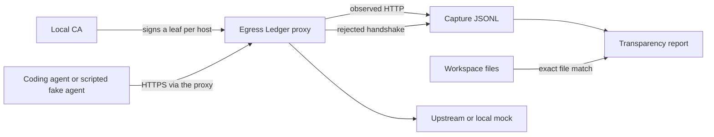
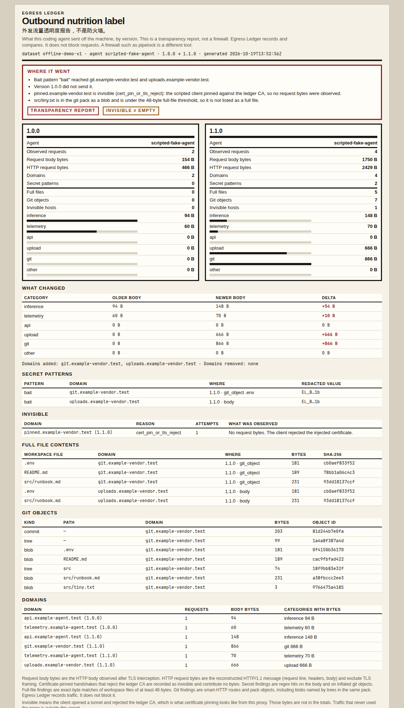
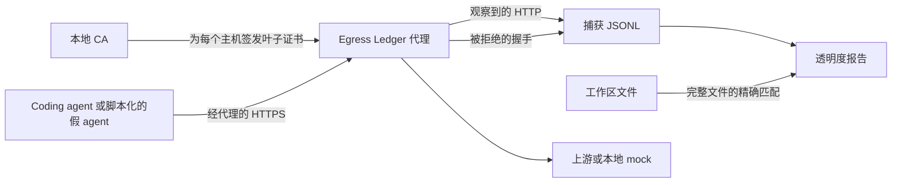

# Egress Ledger

A nutrition label for what your coding agent sends off the machine, one version at a time.

Egress Ledger is a local HTTPS proxy with its own certificate authority. It injects a leaf certificate per destination, records the HTTP the agent actually sent, and writes a transparency report: domains, request size by category, git objects, secret-shaped patterns, and full workspace files. A second version of the same agent produces a diff. Traffic that rejects the injected certificate is marked **invisible**, because the bytes were not observed.

This is a transparency report, not a firewall. [pipelock](https://github.com/pipelab-org/pipelock) (938 stars in the project spec) blocks egress. Egress Ledger does not block anything. It shows what left, and what a newer version started sending.

## The pain

Coding agents phone home, and the payload is rarely on the label.

- Hacker News, [ZCode silently uploads your Git history](https://news.ycombinator.com/item?id=49752422) (262 points in the project spec).
- Hacker News, [privacy analysis of conversational AI agents](https://news.ycombinator.com/item?id=49890226) (426 points in the project spec).
- OpenAI Codex [issue #48195](https://github.com/openai/codex/issues/48195) (185 👍 in the project spec): a background daemon starting by default.

Those three figures are the ones recorded in the project spec on 2026-10-19. This repository did not re-measure them.

## Architecture



The proxy accepts `CONNECT`, answers with a short-lived leaf signed by the local CA, and reads the HTTP inside the tunnel. If the handshake fails because the client does not trust that leaf, the host is stored as invisible and contributes no bytes. Report generation is separate from capture: categories, secret patterns, git packs, and full-file matches run on the JSONL plus the workspace.

Categories, in label order: `inference`, `telemetry`, `api`, `upload`, `git`, `other`. A request gets one category. Findings are independent of that label, so a git blob can still contain a secret and a full file.

## Quickstart

```bash
go build -o egress-ledger ./cmd/egress-ledger

# offline demo: no API key, no real agent
./egress-ledger demo --out examples/demo-output
```

`make build`, `make test`, and `make demo` wrap the same commands. `make demo` also refreshes `docs/demo-report.html` and `docs/measured.json`.

To record an agent you already run:

```bash
./egress-ledger ca init --out "$HOME/.egress-ledger"
./egress-ledger proxy \
  --listen 127.0.0.1:8080 \
  --ca "$HOME/.egress-ledger" \
  --capture session.jsonl \
  --agent your-agent \
  --version 1.2.3
```

Trust `$HOME/.egress-ledger/ca.crt` in that agent (for example `SSL_CERT_FILE`) and point it at `http://127.0.0.1:8080`. Then:

```bash
./egress-ledger report --capture session.jsonl --workspace . --out report.html
./egress-ledger diff --old v1.jsonl --new v2.jsonl --workspace . --out diff.html
```

The CA is not installed into the system trust store. Certificate injection means the proxy presents a leaf it just signed. The agent has to trust the CA or the handshake is invisible on purpose.

## Offline demo

`egress-ledger demo` needs no API key and does not launch Claude Code, Codex, or any other real agent.

1. It writes the embedded bait repo to `examples/demo-output/bait-repo` and makes one git commit. The only secret-shaped value is the fake `EL_BAIT_…` line in `.env`. It is not a credential. Source files live in `internal/demo/bait`.
2. It starts a local CA, an intercepting proxy, and plain HTTP mocks for four `.test` names. Those names are reserved and are mapped only inside the demo.
3. A scripted client, `scripted-fake-agent`, runs twice:
   - **1.0.0** posts an inference request and a telemetry event.
   - **1.1.0** does that, uploads `.env` and `src/runbook.md`, posts a git pack of the repo, and opens `pinned.example-vendor.test` with a trust store that does not contain the ledger CA.
4. It writes `report.html`, `summary.json`, and `diff.json`.

The report from the run that produced the numbers below:



The full page, including file and git-object tables past the screenshot, is [docs/demo-report.html](docs/demo-report.html). Machine-readable totals are [docs/measured.json](docs/measured.json).

On that run the bait pattern was observed at `git.example-vendor.test` (inside the `.env` blob) and `uploads.example-vendor.test` (raw body). Version 1.0.0 did not send it. `pinned.example-vendor.test` is `cert_pin_or_tls_reject`: no request bytes. `src/tiny.txt` is in the pack and is under the 48-byte full-file threshold, so it is not listed as a full file.

## Measured results

Numbers below are from this development environment (Go 1.22.2, git 2.43.0). Two back-to-back `egress-ledger demo` runs produced identical `summary.json` values. git 2.43.0 was used to commit the bait repo and, in `TestPackAcceptedByGit`, to `unpack-objects` and `cat-file` the pack the binary built. Category and body totals do not shell out to git; the pack encoder is in this repo.

Request body bytes are the exact HTTP bodies. HTTP request bytes are a reconstruction with header names sorted, excluding TLS framing. Invisible hosts add nothing to either total.

### offline-demo-v1

Scripted fake agent. Not a capture of a real coding agent.

| | 1.0.0 | 1.1.0 | delta |
|---|---:|---:|---:|
| Observed requests | 2 | 4 | +2 |
| Request body bytes | 154 | 1750 | +1596 |
| HTTP request bytes | 466 | 2429 | +1963 |
| Secret findings | 0 | 2 | +2 |
| Full files (≥ 48 bytes) | 0 | 5 | +5 |
| Git objects | 0 | 7 | +7 |
| Invisible hosts | 0 | 1 | +1 |
| inference body bytes | 94 | 148 | +54 |
| telemetry body bytes | 60 | 70 | +10 |
| api body bytes | 0 | 0 | 0 |
| upload body bytes | 0 | 666 | +666 |
| git body bytes | 0 | 866 | +866 |
| other body bytes | 0 | 0 | 0 |

Domains added in 1.1.0: `git.example-vendor.test`, `uploads.example-vendor.test`.

The 7 git objects are 4 blobs, 2 trees, and 1 commit. The 5 full-file findings are `.env`, `README.md`, and `src/runbook.md` inside the pack, plus `.env` and `src/runbook.md` in the upload body. The 2 secret findings are the bait pattern in that upload body and in the `.env` blob. Both are redacted in the HTML report.

### ledger-fixture-v1

Labeled cases scored by the same classifiers (`classify.EvaluateFixture`). A secret case is exact when the detected pattern set equals the label. A mismatched positive counts as both a false positive and a false negative. The 20 secret cases are 11 positives and 9 negatives.

| Check | Result |
|---|---|
| Secret cases exact | 20/20 |
| Secret true positives | 11 |
| Secret false positives | 0 |
| Secret false negatives | 0 |
| Secret precision | 1 |
| Secret recall | 1 |
| Git cases exact | 6/6 (accuracy 1) |
| Full-file cases exact | 5/5 (accuracy 1) |

### Not run

| Check | Status |
|---|---|
| Capture of Claude Code, Codex, or another real agent | WIP |
| Installing the CA into an operating-system trust store | WIP |
| HTTP/2 interception | WIP |
| Bytes inside a connection that never uses the proxy | Not observable |

## Limits

- Only traffic that uses the proxy can appear. A pin that refuses the ledger CA is invisible. A pin that skips the proxy entirely is absent, which is not the same row.
- `cert_pin_or_tls_reject` means the client opened a tunnel and then rejected the injected certificate. A handshake that hits the deadline is `handshake_timeout` instead. Neither row contains a body.
- Secret detection is a fixed set of patterns (bait prefix, AWS access key id, GitHub tokens, Slack tokens, PEM private-key headers, `sk-` tokens, and a generic assignment). It is not an entropy model.
- A full-file finding is an exact byte match of a workspace file of at least 48 bytes, in the HTTP body or in an inflated git blob. Smaller files are ignored on purpose.
- Stored bodies are capped at 8 MiB.
- The proxy speaks HTTP/1.1 inside the tunnel.

## License

Apache-2.0. See [LICENSE](LICENSE) and [NOTICE](NOTICE). The proxy, CA, classifiers, and report are original code and use only the Go standard library.

---

# 中文

一张营养成分表：你的 coding agent 每个版本到底往外发了什么。

Egress Ledger 是一个带自有证书颁发机构的本地 HTTPS 代理。它按目标主机注入叶子证书，记下 agent 实际发出的 HTTP，并生成透明度报告：域名、按类别的请求大小、git 对象、密钥形态、以及完整的工作区文件。再拿另一个版本做一次 diff。客户端拒绝注入证书的流量标成**不可见**，因为那些字节没有被观察到。

这是透明度报告，不是防火墙。[pipelock](https://github.com/pipelab-org/pipelock)（项目规格里记录为 938 star）负责拦截。Egress Ledger 不拦截。它只说明发走了什么，以及新版本比旧版本多发了什么。

## 痛点

Coding agent 会向外发数据，发的内容很少写在包装上。

- Hacker News，[ZCode silently uploads your Git history](https://news.ycombinator.com/item?id=49752422)（项目规格中的 262 points）。
- Hacker News，[对话式 AI agent 的隐私分析](https://news.ycombinator.com/item?id=49890226)（项目规格中的 426 points）。
- OpenAI Codex [issue #48195](https://github.com/openai/codex/issues/48195)（项目规格中的 185 👍）：默认会拉起后台 daemon。

这三个数字都来自 2026-10-19 的项目规格，本仓库没有重新统计。

## 架构



代理接受 `CONNECT`，用本地 CA 签发的短期叶子证书完成握手，再读取隧道里的 HTTP。如果客户端不信任这张叶子证书而导致握手失败，该主机记为不可见，不计入任何字节。报告在捕获之后生成：类别、密钥模式、git pack、完整文件匹配，都跑在 JSONL 和工作区上。

类别按标签顺序是 `inference`、`telemetry`、`api`、`upload`、`git`、`other`。每个请求只有一个类别。发现项和类别是分开的，所以一个 git blob 里仍然可以同时有密钥和完整文件。

## 快速开始

```bash
go build -o egress-ledger ./cmd/egress-ledger

# 离线演示：不需要 API key，也不需要真实 agent
./egress-ledger demo --out examples/demo-output
```

`make build`、`make test`、`make demo` 是同样的命令。`make demo` 还会刷新 `docs/demo-report.html` 和 `docs/measured.json`。

如果你要记录自己已经在跑的 agent：

```bash
./egress-ledger ca init --out "$HOME/.egress-ledger"
./egress-ledger proxy \
  --listen 127.0.0.1:8080 \
  --ca "$HOME/.egress-ledger" \
  --capture session.jsonl \
  --agent your-agent \
  --version 1.2.3
```

让该 agent 信任 `$HOME/.egress-ledger/ca.crt`（例如设置 `SSL_CERT_FILE`），并把代理指到 `http://127.0.0.1:8080`。然后：

```bash
./egress-ledger report --capture session.jsonl --workspace . --out report.html
./egress-ledger diff --old v1.jsonl --new v2.jsonl --workspace . --out diff.html
```

CA 不会被装进系统信任库。这里的证书注入指代理出示自己刚签发的叶子证书。Agent 必须信任这张 CA，否则握手会按设计变成不可见。

## 离线演示

`egress-ledger demo` 不需要 API key，也不会启动 Claude Code、Codex 或任何真实 agent。

1. 把内嵌的诱饵仓库写到 `examples/demo-output/bait-repo` 并做一次 git commit。唯一的密钥形态在 `.env` 里，是伪造的 `EL_BAIT_…`，不是凭证。源文件在 `internal/demo/bait`。
2. 启动本地 CA、拦截代理，以及四个 `.test` 域名的明文 HTTP mock。这些名字是保留域名，只在演示的映射里指向本机。
3. 脚本客户端 `scripted-fake-agent` 跑两遍：
   - **1.0.0** 发送一次推理请求和一次遥测。
   - **1.1.0** 在此之上上传 `.env` 和 `src/runbook.md`，再提交仓库的 git pack，并用一个不含 ledger CA 的信任库去连 `pinned.example-vendor.test`。
4. 写出 `report.html`、`summary.json` 和 `diff.json`。

下面这张图就是产生后文数字的那次报告：


截图下面的文件表和 git 对象表在完整页面里：[docs/demo-report.html](docs/demo-report.html)。机器可读的合计在 [docs/measured.json](docs/measured.json)。

那一次运行里，诱饵模式出现在 `git.example-vendor.test`（`.env` 这个 blob 里面）和 `uploads.example-vendor.test`（原始请求体）。1.0.0 没有发送它。`pinned.example-vendor.test` 的原因是 `cert_pin_or_tls_reject`：没有请求字节。`src/tiny.txt` 在 pack 里，但短于 48 字节的完整文件阈值，所以不会被列成完整文件。

## 实测结果

下面的数字来自这次开发环境（Go 1.22.2，git 2.43.0）。连续两次 `egress-ledger demo` 得到的 `summary.json` 相同。git 2.43.0 用来提交诱饵仓库；`TestPackAcceptedByGit` 再用它对本二进制生成的 pack 做 `unpack-objects` 和 `cat-file`。类别和 body 字节数不调用 git，pack 编码器在本仓库里。

请求 body 字节是 HTTP body 的精确长度。HTTP 请求字节是按头部名字排序后的重建长度，不含 TLS 帧。不可见主机不计入这两项。

### offline-demo-v1

脚本化的假 agent。不是真实 coding agent 的捕获。

| | 1.0.0 | 1.1.0 | 差值 |
|---|---:|---:|---:|
| 观察到的请求 | 2 | 4 | +2 |
| 请求 body 字节 | 154 | 1750 | +1596 |
| HTTP 请求字节 | 466 | 2429 | +1963 |
| 密钥发现 | 0 | 2 | +2 |
| 完整文件（≥ 48 字节） | 0 | 5 | +5 |
| Git 对象 | 0 | 7 | +7 |
| 不可见主机 | 0 | 1 | +1 |
| inference body 字节 | 94 | 148 | +54 |
| telemetry body 字节 | 60 | 70 | +10 |
| api body 字节 | 0 | 0 | 0 |
| upload body 字节 | 0 | 666 | +666 |
| git body 字节 | 0 | 866 | +866 |
| other body 字节 | 0 | 0 | 0 |

1.1.0 新增的域名：`git.example-vendor.test`、`uploads.example-vendor.test`。

7 个 git 对象是 4 个 blob、2 个 tree、1 个 commit。5 条完整文件发现是 pack 里的 `.env`、`README.md`、`src/runbook.md`，以及上传 body 里的 `.env` 和 `src/runbook.md`。2 条密钥发现是上传 body 和 `.env` blob 里的诱饵模式。HTML 报告里这两条都已打码。

### ledger-fixture-v1

同一套分类器对标注样本的打分（`classify.EvaluateFixture`）。密钥样本只有在检出的模式集合和标注完全一致时才算精确。标成阳性但集合不一致，同时计入假阳性和假阴性。20 条密钥样本里 11 条是阳性，9 条是阴性。

| 检查 | 结果 |
|---|---|
| 密钥样本精确命中 | 20/20 |
| 密钥真阳性 | 11 |
| 密钥假阳性 | 0 |
| 密钥假阴性 | 0 |
| 密钥精确率 | 1 |
| 密钥召回率 | 1 |
| Git 样本精确命中 | 6/6（准确率 1） |
| 完整文件样本精确命中 | 5/5（准确率 1） |

### 没有跑的部分

| 检查 | 状态 |
|---|---|
| 捕获 Claude Code、Codex 或其他真实 agent | WIP |
| 把 CA 装进操作系统信任库 | WIP |
| HTTP/2 拦截 | WIP |
| 根本不走代理的连接里的字节 | 观察不到 |

## 局限

- 只有走了代理的流量才会出现。拒绝 ledger CA 的证书固定是不可见。完全不走代理的固定则不会出现在表里，这和“不可见”不是同一行。
- `cert_pin_or_tls_reject` 表示客户端打开了隧道，然后拒绝了注入的证书。握手超时记为 `handshake_timeout`。这两类都没有 body。
- 密钥检测是固定模式（诱饵前缀、AWS access key id、GitHub token、Slack token、PEM 私钥头、`sk-` token，以及一种通用赋值）。不是熵模型。
- 完整文件发现是工作区里至少 48 字节的文件在 HTTP body 或解压后的 git blob 中的精确字节匹配。更短的文件故意忽略。
- 保存的 body 上限是 8 MiB。
- 隧道内是 HTTP/1.1。

## 许可证

Apache-2.0。见 [LICENSE](LICENSE) 和 [NOTICE](NOTICE)。代理、CA、分类器和报告都是原创代码，只用 Go 标准库。
